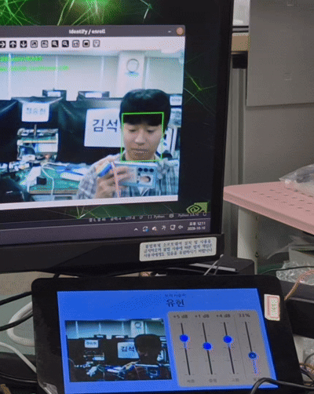
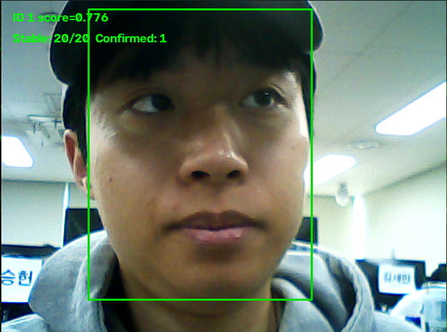
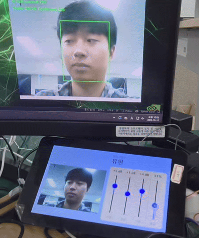

# Smart_EQ : 사용자 맞춤 스마트 EQ 시스템

본 프로젝트는 Jetson의 카메라로 사용자를 인식하고, Raspberry Pi에서 해당 사용자에게 미리 설정된 EQ 프리셋을 적용하는 시스템입니다.

Jetson은 얼굴을 검출하고 등록된 사용자 프로필과 비교하여 사용자 ID를 판정합니다. 판정 결과와 얼굴 상태는 MQTT로 Raspberry Pi에 전달하며, Raspberry Pi는 전달받은 사용자 ID에 맞춰 EQ 설정을 적용합니다.

얼굴 인식 결과가 한 프레임마다 바뀌어 EQ 설정이 불필요하게 전환되는 것을 줄이기 위해 연속 프레임 확인과 IoU 기반의 일시적 Unknown 완화 처리를 적용했습니다.

## 시스템 구성

- **Jetson**: 카메라 영상에서 얼굴을 검출·인식하고 사용자 ID와 얼굴 상태를 전달
- **Raspberry Pi**: 전달받은 사용자 ID에 맞춰 EQ 프리셋 적용, 음악 재생, EQ 저장, LCD 대시보드 표시
- **STM32**: 노브 4개와 버튼 2개의 입력을 읽어 Pi로 전송
- **통신**: MQTT로 상태와 ID를 주고받고, 필요하면 MJPEG로 카메라 영상을 전달. STM32와 Pi는 USB 시리얼로 연결

## 팀원 역할

@3ShotCoffee : Raspberry Pi (오디오·DB·대시보드), STM32 (입력 장치)

@yhsys0429-create : Jetson Vision (얼굴 인식·등록) 

## Raspberry Pi 환경 설정
- OS 패키지: `sudo apt install git libportaudio2 libopenblas0 ffmpeg mariadb-server mosquitto mosquitto-clients`
- 가상환경: `python3 -m venv ~/eq-env` → `source ~/eq-env/bin/activate` → `pip install -r requirements.txt`
- 오디오: `/boot/firmware/config.txt`에 `dtoverlay=max98357a` 추가, `dtparam=audio=on` 주석 처리, 재부팅
- 시리얼 권한: `sudo usermod -aG dialout pi`
- DB: 계정 만들기(SQL) → `use audio`
- `config.py` 생성 후 비밀번호 입력
- 대시보드: `sudo apt install python3-pygame python3-paho-mqtt fonts-nanum`
 
## Jetson Nano 환경 설정

Jetson에서 CUDA를 사용할 수 있는 ONNX Runtime 환경과 프로젝트의
Python 의존성을 준비해야 합니다. Pi와 Jetson은 같은 MQTT 브로커에
접속할 수 있어야 합니다.

주요 실행 옵션은 다음과 같습니다.

- `--camera`: 카메라 인덱스
- `--threshold`: 얼굴 유사도 판정 기준
- `--stable-frames`: ID 확정에 필요한 연속 프레임 수
- `--samples`: 사용자 등록 샘플 수
- `--no-mqtt`: MQTT 비활성화
- `--video-allowed-ip`: MJPEG 접속을 허용할 Pi 주소

## Vision 기능

### 얼굴 검출 및 사용자 식별

InsightFace의 `buffalo_sc` 모델로 얼굴 임베딩을 만들고,
등록된 사용자 임베딩과 코사인 유사도를 비교합니다.
유사도가 기준값보다 낮으면 Unknown으로 판정합니다.

### 여러 얼굴 중 대상 선택

화면에 얼굴이 여러 명 잡히면 바운딩 박스 면적이 가장 큰 얼굴 하나를
주 인식 대상으로 선택합니다. 가까운 사용자를 우선 처리하기 위한 정책입니다.



### 연속 프레임 확인

한 프레임의 결과만으로 ID를 바로 바꾸지 않습니다.
같은 ID가 설정된 프레임 수만큼 연속 확인되면 사용자를 확정해 Pi로 전달합니다.
이 과정을 통해 순간적인 인식 변화로 EQ가 자주 바뀌는 현상을 줄입니다.



### IoU를 이용한 일시적 Unknown 완화

확정된 사용자가 잠깐 Unknown으로 판정되더라도 현재 얼굴 박스와
직전 확정 박스의 IoU가 기준 이상이면 기존 ID를 유지합니다.
잠깐의 인식 흔들림 때문에 EQ가 바뀌는 현상을 완화하기 위한 보조 처리입니다.



### 신규 사용자 등록

등록 과정에서 여러 얼굴 샘플을 모아 임베딩 프로필을 저장합니다.
이미 등록된 사용자로 판정되면 중복 촬영을 막습니다.

## Raspberry Pi 기능

### 실시간 3밴드 EQ

음악을 반복 재생하면서 저음(200 Hz)·중음(1 kHz)·고음(4 kHz) 필터를 실시간으로 적용합니다.
각 밴드는 −12 ~ +12 dB, 볼륨은 −60 ~ 0 dB 범위에서 노브 한 칸에 1 dB씩 바뀝니다.
볼륨이 바뀔 때는 서서히 변하게 해서 "툭" 소리가 나지 않습니다.

### 사용자별 EQ 저장·불러오기

Jetson에서 사용자 ID를 받으면 MariaDB에서 그 사용자의 EQ를 불러와 적용합니다.
처음 보는 사용자는 기본값(모든 밴드 0 dB, 볼륨 −20 dB)으로 시작합니다.
노브 조절이 멈추고 1초가 지나면 현재 사용자의 EQ를 자동 저장하고,
사용자가 바뀌기 직전에도 저장 안 된 값을 먼저 저장합니다.

### LCD 대시보드

카메라 영상, 현재 사용자, EQ·볼륨 슬라이더를 LCD 전체 화면에 표시합니다.
등록 모드에서는 얼굴 상태에 따라 "화면에 가까이 와 주세요" 같은 안내 문구를 보여 줍니다.

### 자동 재연결

MQTT 브로커, STM32 시리얼, 카메라 영상이 끊겨도 프로그램이 멈추지 않고 자동으로 다시 연결합니다.

## STM32 기능

### 노브 입력

로터리 엔코더 4개를 타이머 엔코더 모드로 읽어, 돌린 칸 수를 Pi로 보냅니다.

| 노브 | 조절 대상 | 메시지 예시 |
|---|---|---|
| B1 | 저음 | `B1:+1` |
| B2 | 중음 | `B2:-1` |
| B3 | 고음 | `B3:+2` |
| B4 | 볼륨 | `B4:-1` |

### 버튼 입력

버튼 2개를 10 ms마다 읽고, 채터링을 걸러 눌렸을 때만 `S1:1`, `S2:1`을 보냅니다.
Pi가 이를 MQTT로 Jetson에 전달해 **S1은 등록 시작, S2는 등록 취소**로 동작합니다.

## MQTT 메시지

| 토픽 | 용도 | 예시 |
|---|---|---|
| `face/user_id` | 확정된 사용자 ID 전달 | `{"user_id": 128, "name": "사용자 이름"}` |
| `face/state` | 얼굴 검출 및 등록 상태 전달 | `{"state": "no_face"}` |
| `face/mode` | 인식/등록 모드 전달 | `{"mode": "recognize"}` |
| `button` | 버튼 입력 전달 (Pi → Jetson) | `{"button": 1}` |
| `eq/state` | 현재 사용자와 EQ 값 (대시보드용) | `{"user_id": 128, "low": 3.0, "mid": 0.0, "high": -2.0, "vol": -20.0, "muted": false}` |

얼굴이 없는 `no_face` 상태와, 얼굴은 있지만 등록되지 않은 `Unknown`은
서로 다른 상태로 처리합니다.

## 사용 기술

| 파트 | 기술 |
|---|---|
| Vision (Jetson) | Python, OpenCV, InsightFace (`buffalo_sc`), ONNX Runtime CUDA, NumPy, Flask / MJPEG |
| Raspberry Pi | Python, NumPy / SciPy (EQ 필터), sounddevice, MariaDB (PyMySQL), pygame, pyserial |
| STM32 | C, STM32CubeIDE / HAL, Nucleo-F411RE |
| 통신 | MQTT (Mosquitto, Paho MQTT), USB 시리얼 (UART 115200) |
| 하드웨어 | Jetson, Raspberry Pi, STM32 Nucleo, MAX98357A 앰프, 로터리 엔코더, LCD, 웹캠 |

## 실행

**Jetson**
```bash
python3 recognize_and_register_improved.py
```

**Raspberry Pi**
```bash
cd pi
python main.py                  # 오디오 + MQTT + 시리얼
/usr/bin/python3 dashboard.py   # LCD 대시보드
```

**STM32**: STM32CubeIDE에서 `stm32/` 프로젝트를 빌드해 보드에 올리고, Pi에 USB로 연결합니다.
